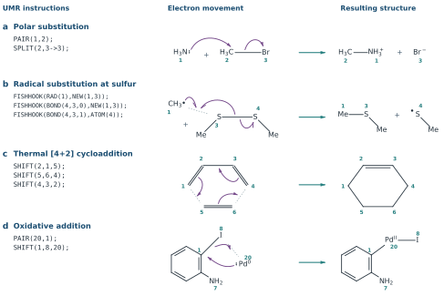

# UMR 1.0

[简体中文](README.zh-CN.md) · [Language walkthrough](docs/language.md) · [Paper figures and results](paper/README.md) · [UMR 1.0 release](https://github.com/SrCO3/UMR-Language/releases/tag/v1.0.0)

**UMR: A Lean-Style Language for Representation and Structural Verification of Organic Reaction Mechanisms**  
Sirui Shao, Haichuan Tan, Tao Huang and Bowen Gao

Unified Mechanism Representation (UMR) represents polar, radical, pericyclic and organometallic mechanisms as elementary events on atom-mapped Lewis structures. A chemist or language model proposes the electron movements. The checker tests their sources, bond changes, local electronic configurations, atom inventory and total charge. The executor constructs the next intermediate or identifies the event to revise. A submitted path can be replayed independently from its initial structure.



## Run an elementary event

Clone this repository and run the commands in its root using Python in a virtual environment. The drawing command below also works on a headless machine with `QT_QPA_PLATFORM=offscreen`.

```sh
python -m pip install -r requirements.txt
python umr.py examples/paper-1.0/substitution.umr
```

In this S<sub>N</sub>2 reaction, ammonia donates its lone pair on N1 to methyl carbon C2, and the C2–Br3 bonding pair moves to Br3. The two actions commit together.

```text
PAIR(1,2);
SPLIT(2,3->3);
```

The program returns `{"status": "passed", "events": 1, "strict": true, "errors": []}`. Try the [input with the second arrow omitted](examples/paper-1.0/substitution-omitted-arrow.umr) to see the rule that rejects the incomplete event. For a four-event example, follow Pd through the [Larock indole synthesis](examples/paper-1.0/larock.umr).

```sh
python umr.py examples/paper-1.0/larock.umr --receipt larock.json --draw larock-diagram
```

Open `larock-diagram/mechanism_chain.svg` for the complete path. The JSON receipt records the intermediate structures and the outcome of each event. The [walkthrough](docs/language.md) explains how to read a receipt, what changes in a radical or pericyclic event, and how to declare a local rule for a singlet silylene.

## Named reaction library

The two textbook catalogues contain **528 entries linked to 321 distinct UMR programs**. Each entry identifies a reaction and its printed page. A linked program specifies the substrate, atom mapping and events for a particular example.

| Catalogue | Entries | Executable material |
|---|---|---|
| [Jie Jack Li, *Name Reactions*, 4th ed.](named-reactions/Li.md) | 277 main entries and one separately indexed subentry | 191 records replay their declared sequence, 80 contain a partial path or an exception, one describes the measured organic net transformation, and six provide a source reference. |
| [László Kürti and Barbara Czakó, *Strategic Applications of Named Reactions in Organic Synthesis*](named-reactions/Kurti-Czako.md) | 250 printed chapters | 48 substrate-specific examples with 210 replayed events. |

```sh
python named_reactions.py --find Larock
python named_reactions.py --show STR-260
python named_reactions.py --replay STR-260
```

The Larock entry is on p. 260. Replay gives `passed  events=4  strict=True`. The tool verifies the input digest and compares the status, event count and strictness with the catalogue record. `--check-all` applies this comparison to every linked program, including records with partial paths and declared exceptions.

## Mechanism inference on FukuyamaBench

In *Pathway-only Prediction*, GPT-6.2 Astra received the starting materials, known product and ordered conditions. Both settings used four demonstrations matched in chemical content, medium reasoning effort and one attempt per question. A complete match requires all official structural checkpoints in order.

| Problem set | Without UMR | UMR with executor | Net gain |
|---|---:|---:|---:|
| A · Introductory | 23/78 (29.5%) | 37/78 (47.4%) | +14 |
| B · Graduate level | 30/131 (22.9%) | 35/131 (26.7%) | +5 |
| C · Research laboratories | 9/110 (8.2%) | 11/110 (10.0%) | +2 |
| **All** | **62/319 (19.4%)** | **83/319 (26.0%)** | **+21** |

Of the 319 questions, 50 were solved only with UMR and 29 only without it. All 306 submitted UMR paths could be replayed, and 83 matched the full reference pathway. The replay checks structural consistency. Which pathway a reaction follows under the given conditions also depends on chemical selectivity.

Run `python paper/summarize_scores.py` to reproduce the totals from Appendix C. The C035 example shows the bond order that differed between the two submissions. [Per-case scores](paper/pathway-scores.csv) · [Case study and figures](paper/README.md)

## License and attribution

The code is licensed under MIT. The authors' named-reaction catalogue, data and programs are licensed under CC BY 4.0, including copies distributed under `src/` and `examples/`. Third-party components retain their own licenses. See the [notice and file-level scope](NOTICE.md) and [citation](CITATION.cff).
