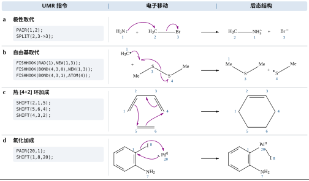

# UMR 1.0

[English](README.md) · [语言入门](docs/language.zh-CN.md) · [论文图例与实验结果](paper/README.zh-CN.md) · [UMR 1.0 发布版](https://github.com/SrCO3/UMR-Language/releases/tag/v1.0.0)

**UMR：用于有机反应机理表示与结构验证的 Lean 式语言**  
邵思睿、谭海川、黄韬、高博文

UMR（Unified Mechanism Representation）用带原子映射的 Lewis 结构和基元事件表示极性、自由基、周环和有机金属反应。化学家或语言模型提出电子如何移动，检查器核对电子来源、成断键、局部电子态、原子库存和总电荷。执行器据此生成下一中间体，或指出需要修改的事件。提交的路径可以从初态独立回放。



## 运行一个基元事件

克隆仓库后，在 Python 虚拟环境中从仓库根目录运行以下命令。若在无图形界面的服务器上绘图，可设置环境变量 `QT_QPA_PLATFORM=offscreen`。

```sh
python -m pip install -r requirements.txt
python umr.py examples/paper-1.0/substitution.umr
```

在这步 S<sub>N</sub>2 反应中，氨的 N1 用一对孤对电子与甲基碳 C2 成键，C2–Br3 键上的电子对归 Br3。两个动作在同一个事件内提交。

```text
PAIR(1,2);
SPLIT(2,3->3);
```

程序返回 `{"status": "passed", "events": 1, "strict": true, "errors": []}`。运行[删去第二根弯箭的输入](examples/paper-1.0/substitution-omitted-arrow.umr)，可以查看 S<sub>N</sub>2 动作组合检查的实际报错。要观察基元事件如何接成催化路径，可以沿 [Larock 吲哚合成](examples/paper-1.0/larock.umr)追踪钯的四次变化。

```sh
python umr.py examples/paper-1.0/larock.umr --receipt larock.json --draw larock-diagram
```

打开 `larock-diagram/mechanism_chain.svg` 即可查看连续机理图。`larock.json` 保存各步中间体和事件的执行结果。[语言入门](docs/language.zh-CN.md)用实际输入说明如何读回执、如何写自由基及周环事件，以及如何为单重态硅宾声明局部规则。

## 人名反应库

两部教材共收录 **528 个目录条目，关联 321 份不同的 UMR 程序**。目录条目给出反应名称和教材页码，关联程序给出具体底物、原子映射和基元事件。

| 教材目录 | 收录范围 | 可回放内容 |
|---|---|---|
| [Jie Jack Li，《Name Reactions》第四版](named-reactions/Li.md) | 277 个主条目，另有 1 个单列的子条目 | 191 条可回放其声明的事件序列，80 条含部分路径或规则例外，1 条记录实测有机净转化，6 条仅列出处。 |
| [László Kürti、Barbara Czakó，《Strategic Applications of Named Reactions in Organic Synthesis》](named-reactions/Kurti-Czako.md) | 全部 250 章 | 48 个有具体底物的实例，共回放 210 个事件。 |

```sh
python named_reactions.py --find Larock
python named_reactions.py --show STR-260
python named_reactions.py --replay STR-260
```

Larock 条目对应第 260 页，回放结果为 `passed  events=4  strict=True`。程序核对输入文件哈希，并将本次状态、事件数和严格验证结果与条目记录逐项对照。`--check-all` 对全部已挂接程序进行同样的核对，包括保留部分路径和声明例外的记录。

## FukuyamaBench 机理推导实验

在已知终产物的 *Pathway-only Prediction* 任务中，两组均由 GPT-6.2 Astra 根据起始物、终产物和有序条件推导中间步骤。两组均采用中等推理强度，四个示范的化学内容相同，每题各作答一次。按顺序命中全部官方结构检查点，该题才计为完整机理命中。

| 题集 | 未使用 UMR | UMR 与执行器 | 净增 |
|---|---:|---:|---:|
| A · 基础机理 | 23/78（29.5%） | 37/78（47.4%） | +14 题 |
| B · 研究生难度 | 30/131（22.9%） | 35/131（26.7%） | +5 题 |
| C · 研究实验室问题 | 9/110（8.2%） | 11/110（10.0%） | +2 题 |
| **全部** | **62/319（19.4%）** | **83/319（26.0%）** | **+21 题** |

逐题对照，50 题仅 UMR 组命中，29 题仅未使用 UMR 的组命中。306 份已提交的 UMR 路径均可回放，其中 83 份命中完整参考路径。回放检验各步的结构是否自洽，哪条路径在给定条件下占优还取决于反应的选择性。

在仓库根目录运行 `python paper/summarize_scores.py` 可从附录 C 逐题复算以上数字。C035 实例展示了两份作答在哪根键上产生差异。[逐题成绩](paper/pathway-scores.csv) · [案例与论文图例](paper/README.zh-CN.md)

## 许可与引用

代码采用 MIT 许可。作者整理的人名反应目录、数据和原生程序采用 CC BY 4.0 许可，包括在 `src/` 和 `examples/` 中分发的副本。第三方组件沿用各自许可。文件范围和署名要求见[许可说明](NOTICE.md)，引用信息见 [CITATION.cff](CITATION.cff)。
