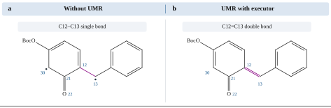

# Figures, programs and benchmark results

[中文](README.zh-CN.md) · [UMR language walkthrough](../docs/language.md) · [Repository](../README.md)

**UMR: A Lean-Style Language for Representation and Structural Verification of Organic Reaction Mechanisms**  
Sirui Shao, Haichuan Tan, Tao Huang and Bowen Gao

## Read the figures alongside the programs

| In the paper | What to inspect | Source or result |
|---|---|---|
| [Figure 1 · Four elementary events](../docs/figures/elementary-events.en.svg) | Read each row from UMR instructions through the electron movements to the successor. The three fishhooks in row b each move one electron. The three arrows in row c move electron pairs in a single concerted event. | [Polar](../examples/paper-1.0/substitution.umr) · [Radical](../examples/paper-1.0/radical-substitution.umr) · [Pericyclic](../examples/paper-1.0/cycloaddition.umr) · [Organometallic](../examples/paper-1.0/oxidative-addition.umr) |
| [Figure 2 · Larock indole synthesis](../docs/figures/larock.en.svg) | Follow the aryl–Pd bond through alkyne insertion and the C12–N7 bond through ring closure. The fourth event regenerates Pd(0). | [Four-event program](../examples/paper-1.0/larock.umr) · [Textbook entry STR-260](../named-reactions/programs/kurti-czako/STR-260.json) |
| [Figure 3 · Complete-pathway accuracy](../docs/figures/pathway-accuracy.en.svg) | The two Astra series use the same model and cases. The Gemini series gives the values reported under the original benchmark protocol. | [Appendix C score table](pathway-scores.csv) · [FukuyamaBench, Table 3](https://arxiv.org/html/2607.12771#S4.T3) |
| [Figure 4 · C035 after elimination](../docs/figures/c035.en.svg) | Compare the C12–C13 bond and the radical sites in the two submitted structures. | [Case study below](#case-c035) |
| [Figure 5 · Enolate resonance](../docs/figures/enolate.en.svg) | The two Lewis views put the negative charge on different atoms of one enolate. | [Enolate](../examples/paper-1.0/enolate.umr) · [Reactions from the two views](../examples/paper-1.0/enolate-branches.umr) |
| [Figure 6 · Element rules](../docs/figures/element-rules.en.svg) | The table displays all 118 elements. Colour marks the rule family. There are built-in rules for 67 elements. Dots identify the 29 elements whose local bonding or electronic state changed in the replayed examples. | [Element rules](../src/mechanism_workbench/umr/v10/elements.py) · [Oxidation states](../src/mechanism_workbench/umr/v10/oxidation-states.csv) · [Singlet silylene](../examples/paper-1.0/silylene.umr) |
| [Figure 7 · Appendix B.4](../docs/figures/larock-tree.en.svg) | The four branches are the four events in the Larock reaction, in execution order. The ten instructions are grouped under the events to which they belong. | [Larock program](../examples/paper-1.0/larock.umr) |

The first input below is the executable listing printed in Appendix A. It produces methylammonium and bromide. The second input omits the leaving-group arrow. The checker reports `Actions do not match SN2 combination rule` and commits zero events. [Appendix A listing](../examples/paper-1.0/appendix-substitution.umr)

```sh
python umr.py examples/paper-1.0/appendix-substitution.umr
python umr.py examples/paper-1.0/substitution-omitted-arrow.umr
```

For the four-step Larock example, the receipt records the intermediate structures and the drawing command produces `larock-diagram/mechanism_chain.svg`.

```sh
python umr.py examples/paper-1.0/larock.umr --receipt larock.json --draw larock-diagram
python named_reactions.py --replay STR-260
```

## Recalculate Figure 3 and Table 2

The task is *Pathway-only Prediction*. Each Astra condition received the starting materials, an observed product and ordered conditions, with four demonstrations matched in chemical content. Each question was attempted once per condition. The official scorer checks whether all required structural checkpoints are matched in order. The full-score column is the per-question outcome returned by the evaluator used in the manuscript. [Official evaluator at the study revision](https://github.com/HaCTang/ReactionMechanismReasoning/blob/63bb79f912f0b2de593996b80ffeea894f6f1a59/eval/eval_infer_pathway.py)

Run this command from the repository root with standard Python to calculate the two Astra series, subset counts, paired outcomes and checkpoint totals from Appendix C.

```sh
python paper/summarize_scores.py
```

The [CSV](pathway-scores.csv) has one row per registered question. `checkpoints` is the required count. For each condition, `*_full` is 0 or 1 and `*_matched` is the number of reference checkpoints matched. `with_umr_submission` records the two footnotes in Appendix C. Eleven cases had no native submission and two had unconfirmed delivery. All thirteen retain their recorded zero scores and count in the denominator.

Of 1,198 required checkpoints, 367 matched without UMR and 434 with UMR. The executor replayed 1,993 events across 306 submitted UMR paths. The full-path totals were 62 and 83, including 33 cases both methods solved. Metered usage, including cached input, was 1,229,668 tokens without UMR and 83,557,804 with UMR. The UMR condition made 3,602 tool requests.

## Case C035

At step 4 the answer without UMR described formation of C12=C13 in an *ortho*-quinone methide. The submitted structure had a single bond there and one unpaired electron on each of C13 and C30. The UMR elimination generated a closed-shell intermediate with C12=C13 and C21=O22.



At the next step, the model assigned O22 to a role that required carbon. The checker returned `requires C at mapped atom 22`. From the preserved intermediate the model submitted a general pericyclic event using the same three electron-pair movements. It formed O22–C32 and C13–C31. The answers matched 0/3 and 3/3 official checkpoints, respectively. All three precede the cycloaddition. Unreacted ethyl vinyl ether in the earlier direct submissions also affected the species-set comparison.
