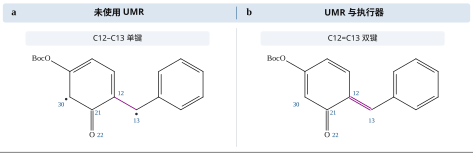

# 论文图例、原生程序与实验结果

[English](README.md) · [UMR 语言入门](../docs/language.zh-CN.md) · [仓库首页](../README.zh-CN.md)

**UMR：用于有机反应机理表示与结构验证的 Lean 式语言**  
邵思睿、谭海川、黄韬、高博文

## 对照机理图阅读程序

| 论文位置 | 图中看什么 | 对应程序或数据 |
|---|---|---|
| [图 1 · 四类基元事件](../docs/figures/elementary-events.zh.svg) | 从左到右读 UMR 指令、电子移动和后态。b 中的三条鱼钩箭各移动一个电子，c 中的三条双电子弯箭属于同一个协同事件。 | [极性取代](../examples/paper-1.0/substitution.umr) · [自由基取代](../examples/paper-1.0/radical-substitution.umr) · [周环反应](../examples/paper-1.0/cycloaddition.umr) · [金属氧化加成](../examples/paper-1.0/oxidative-addition.umr) |
| [图 2 · Larock 吲哚合成](../docs/figures/larock.zh.svg) | 沿芳基–Pd 键读炔烃插入，沿 C12–N7 键读闭环。第四个事件再生 Pd(0)。 | [四步原生程序](../examples/paper-1.0/larock.umr) · [教材实例 STR-260](../named-reactions/programs/kurti-czako/STR-260.json) |
| [图 3 · 完整机理命中率](../docs/figures/pathway-accuracy.zh.svg) | Astra 两组使用同一基模和题集。Gemini 一列取自 FukuyamaBench 原论文的测试协议。 | [附录 C 逐题成绩](pathway-scores.csv) · [FukuyamaBench 表 3](https://arxiv.org/html/2607.12771#S4.T3) |
| [图 4 · C035 消除后的中间体](../docs/figures/c035.zh.svg) | 对照两份作答中 C12–C13 的键级和未成对电子的位置。 | [下文 C035 案例](#c035-案例) |
| [图 5 · 烯醇负离子共振式](../docs/figures/enolate.zh.svg) | 同一烯醇负离子的两张 Lewis 结构将负电荷分别写在碳和氧上。 | [共振](../examples/paper-1.0/enolate.umr) · [从两个共振式出发的反应](../examples/paper-1.0/enolate-branches.umr) |
| [图 6 · 元素规则](../docs/figures/element-rules.zh.svg) | 周期表列出 118 个元素，底色标明规则类别。67 个元素有内置规则，圆点标出 29 个在回放实例中局部成键或电子态发生变化的元素。 | [元素规则](../src/mechanism_workbench/umr/v10/elements.py) · [氧化态](../src/mechanism_workbench/umr/v10/oxidation-states.csv) · [单重态硅宾](../examples/paper-1.0/silylene.umr) |
| [图 7 · 附录 B.4](../docs/figures/larock-tree.zh.svg) | 四个分支按执行顺序对应 Larock 反应的四个基元事件。十条电子指令分别列在所属事件下。 | [Larock 原生程序](../examples/paper-1.0/larock.umr) |

下面第一份输入就是附录 A 列出的完整程序。执行后得到甲铵离子和溴离子。第二份省去了离去基团的弯箭，检查器返回 `Actions do not match SN2 combination rule`，已执行事件数为零。[附录 A 原生程序](../examples/paper-1.0/appendix-substitution.umr)

```sh
python umr.py examples/paper-1.0/appendix-substitution.umr
python umr.py examples/paper-1.0/substitution-omitted-arrow.umr
```

运行下面两条命令可回放四步 Larock 反应并核对教材条目。回执记录各步中间体，连续机理图写入 `larock-diagram/mechanism_chain.svg`。

```sh
python umr.py examples/paper-1.0/larock.umr --receipt larock.json --draw larock-diagram
python named_reactions.py --replay STR-260
```

## 复算图 3 与表 2

实验采用已知终产物的 *Pathway-only Prediction*。Astra 两组都获得起始物、已知产物、有序条件和四个化学内容相同的示范，每题每组独立作答一次。官方评分器依次匹配参考结构检查点，逐题表中的完整命中取自论文采用的评分器。[本次使用的官方评分程序](https://github.com/HaCTang/ReactionMechanismReasoning/blob/63bb79f912f0b2de593996b80ffeea894f6f1a59/eval/eval_infer_pathway.py)

在仓库根目录用标准 Python 运行下列命令，可从附录 C 复算 Astra 两组的分区命中率、同题配对结果及检查点总数。

```sh
python paper/summarize_scores.py
```

[逐题 CSV](pathway-scores.csv) 每行对应一道题。`checkpoints` 为该题所需的检查点数。两组的 `*_full` 取 0 或 1，`*_matched` 为实际命中的检查点数。`with_umr_submission` 区分附录 C 的两种脚注，11 题未提交原生路径，另有 2 题交付中断、提交状态未确认。这 13 题均按原记录以零分计入分母。

全部 1,198 个检查点中，未使用 UMR 命中 367 个，使用 UMR 命中 434 个。执行器回放了 306 份提交路径中的 1,993 个事件。两组完整机理分别命中 62 题和 83 题，其中 33 题两组均命中。计入缓存输入后，未使用 UMR 共消耗 1,229,668 token，使用 UMR 共消耗 83,557,804 token，后者调用工具 3,602 次。

## C035 案例

未使用 UMR 的答卷在第 4 步写明消除生成邻醌甲基化物，C12 与 C13 形成双键。实际提交的结构把这根键写成了单键，按结构读取，C13 和 C30 各有一个未成对电子。UMR 组的消除事件生成含 C12=C13 和 C21=O22 的闭壳层中间体。



在下一步环加成中，模型将 O22 放到了要求为碳的反应位点，检查器返回 `requires C at mapped atom 22`。模型从保留的中间体改用通用周环事件，沿用三条双电子弯箭，一步形成 O22–C32 和 C13–C31。两份作答分别命中 0/3 和 3/3 个官方检查点。三个检查点全部位于最后环加成之前，直接作答还在较早步骤的产物中列入了未反应的乙基乙烯基醚，也影响了物种集合的比对。
